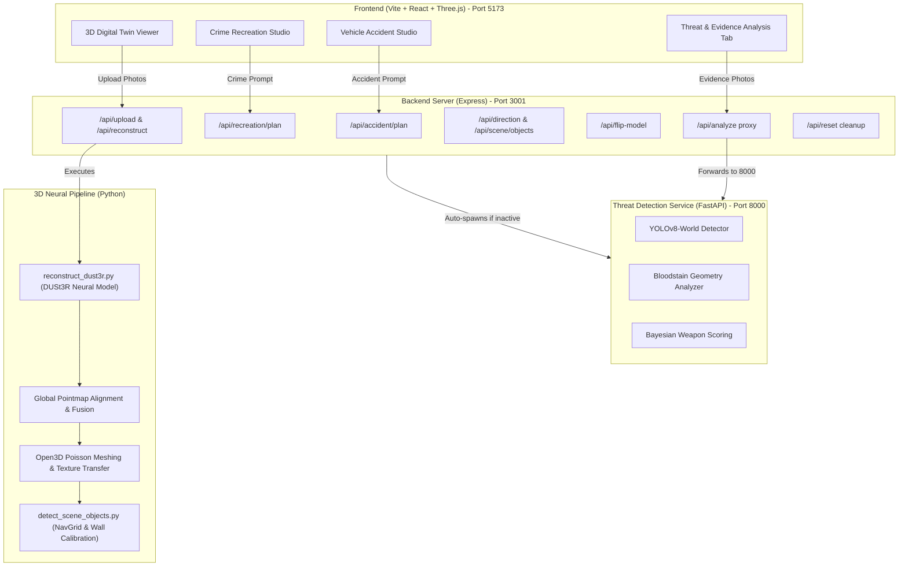

# 🏛️ AI Forensics & 3D Crime Scene Reconstruction

An end-to-end, AI-powered forensic spatial analysis platform. This system reconstructs textured 3D digital twins of physical crime scenes from multi-view photographs using **DUSt3R neural 3D reconstruction**, reenacts dynamic criminal incidents with animated 3D human mannequins and obstacle-avoiding navigation, simulates vehicular and rail collisions in a forensic accident studio, and performs open-vocabulary weapon and bloodstain threat probability detection.

---

## 📑 Table of Contents

- [✨ Key Features](#-key-features)
- [🏗️ System Architecture](#️-system-architecture)
- [⚙️ Prerequisites & System Requirements](#️-prerequisites--system-requirements)
- [🪟 Windows Setup Guide (Step-by-Step)](#-windows-setup-guide-step-by-step)
  - [Phase 1: One-Time Windows Prerequisites](#phase-1-one-time-windows-prerequisites)
  - [Phase 2: Clone & Directory Navigation](#phase-2-clone--directory-navigation)
  - [Phase 3: Install Node.js Dependencies](#phase-3-install-nodejs-dependencies)
  - [Phase 4: Setup 3D Reconstruction Python Virtual Environment](#phase-4-setup-3d-reconstruction-python-virtual-environment)
  - [Phase 5: Setup Threat Detection Python Virtual Environment](#phase-5-setup-threat-detection-python-virtual-environment)
- [🍏 macOS / 🐧 Linux Quick Setup](#-macos---linux-quick-setup)
- [🚀 How to Run on Windows](#-how-to-run-on-windows)
  - [Option A: Standard 2-Terminal Run (Recommended)](#option-a-standard-2-terminal-run-recommended)
  - [Option B: Explicit 3-Terminal Run (Independent Microservices)](#option-b-explicit-3-terminal-run-independent-microservices)
- [🧭 Module Walkthrough & Usage](#-module-walkthrough--usage)
  - [1. 🏢 3D Digital Twin Reconstruction](#1--3d-digital-twin-reconstruction)
  - [2. 🎬 Crime Recreation Studio](#2--crime-recreation-studio)
  - [3. 🚗 Forensic Vehicle & Rail Accident Reconstruction Studio](#3--forensic-vehicle--rail-accident-reconstruction-studio)
  - [4. 🔬 Threat & Evidence Analysis (FORENSIQ)](#4--threat--evidence-analysis-forensiq)
- [📡 API Endpoints Overview](#-api-endpoints-overview)
- [🛠️ Windows-Specific Troubleshooting & Fixes](#️-windows-specific-troubleshooting--fixes)

---

## ✨ Key Features

1. **🏢 Neural 3D Digital Twin Reconstruction**:
   - **DUSt3R Neural Reconstruction**: Predicts dense 3D pointmaps and confidence weights directly from unconstrained, uncalibrated photographs without fragile SfM feature matching.
   - **Global Coordinate Fusion & Alignment**: Optimizes camera poses and point clouds via Minimum Spanning Tree (MST) and gradient descent alignment.
   - **Open3D Surface Meshing & Color Transfer**: Generates watertight surfaces with Poisson Surface Reconstruction and transfers photographic color maps.
   - **Local Floor Plane Fitting & Leveling**: Automatically estimates floor slope, levels geometry to Three.js canonical +Y-up orientation, and centers the room at origin.
   - **Automated Lifecycle & 1-Click Orientation Flip**: Cleans stale models upon new photo uploads and supports instant 180° room orientation flipping (`/api/flip-model`).

2. **🎬 Crime Incident Reenactment Studio**:
   - **Gemini AI & Rule-Based Incident Planner**: Converts natural language statements (e.g. _"The killer entered through the north door, approached the victim sitting on the couch, attacked, and fled via the east door"_) into chronologically staged simulation events.
   - **Proportional 3D Forensic Mannequins**: Dummy heights scale dynamically to match room ceiling height, executing natural postures (standing, sitting, fallen/prone).
   - **Obstacle-Avoiding 3D Navigation Grid (A\*)**:
     - Strict step-height rejection ($\le 12\text{cm}$) and smooth elevation penalties prevent dummies from stepping on furniture or elevated curbs.
     - Radius-aware Line-of-Sight (LOS) corridor clearance maintains safe clearance around furniture corners.
     - Physical object stamping marks tables, sofas, chairs, and beds onto the occupancy grid.
     - Natural standoff positioning: Attackers reach close contact distance ($0.38\text{m}\text{--}0.55\text{m}$) on walkable floor space without clipping objects.
     - Placement freedom: Victims can be seated or positioned directly on furniture without deflection.
     - Impenetrable perimeter floor bounds prevent dummies from stepping outside walls.
   - **8-Cardinal Compass & Wall Calibration**: Calibrates cardinal directions (N, NE, E, SE, S, SW, W, NW) and doorway portals to match physical room walls.
   - **Interactive Playback**: 60 FPS timeline scrubber, variable playback speed ($0.5\times$ to $4\times$), multi-angle camera modes (Director, Tactical 2D Overhead, Orbit, Follow Target), and video recording.

3. **🚗 Forensic Vehicle & Rail Accident Reconstruction Studio**:
   - **Multi-Modal Collision Planner**: Simulates high-speed vehicle collisions, intersection T-bones, rear-ends, pedestrian impacts, and train derailments from plain natural language prompts.
   - **Dynamic Kinematics & Skid Modeling**: Computes yaw angles ($\text{atan2}(-dx, -dz)$), forward momentum vectors, impact velocities, braking friction decelerations, and realistic post-crash resting orientations.
   - **Procedural Environments**: Automatically spawns road intersections, multi-lane highways, rail corridors, and grade-crossings with asphalt textures and road markings.
   - **Playback & Tactical Perspectives**: Synchronized 60 FPS timeline scrub, driver perspective, follow camera, orbit controls, and live velocity readouts.

4. **🔬 AI Weapon & Threat Probability Detection (`FORENSIQ`)**:
   - **Open-Vocabulary YOLO-World**: Detects potential weapons (knives, firearms, blunt objects) and distinguishes them from everyday room objects.
   - **Bloodstain Geometry Segmentation**: Dual-threshold color segmentation maps impact spatters and blood pools with contour polygons.
   - **Bayesian Forensic Scoring**: Computes weapon probability ($0\text{--}100\%$) based on spatial proximity to bloodstains, object lethality, and blood contact transfer.
   - **Interactive Canvas**: High-precision bounding boxes, proximity connector lines, polygon overlays, and downloadable forensic summary reports.

---

## 🏗️ System Architecture



---

## ⚙️ Prerequisites & System Requirements

| Tool | Recommended Version | Purpose | Windows Download Link |
| --- | --- | --- | --- |
| **Operating System** | Windows 10 (Build 19041+) or Windows 11 | Host OS | — |
| **Git for Windows** | `2.40.x`+ (with Git Bash) | Version control & submodule cloning | [git-scm.com/download/win](https://git-scm.com/download/win) |
| **Node.js** | `v18.x`, `v20.x` or `v22.x` (LTS) | Express backend & React Vite frontend | [nodejs.org/en/download](https://nodejs.org/en/download/) |
| **Python** | `3.10`, `3.11`, or `3.12` (64-bit) | DUSt3R 3D engine & FastAPI backend | [python.org/downloads/windows](https://www.python.org/downloads/windows/) |
| **Visual C++ Redistributable** | 2015–2022 (x64) | Required for Open3D, PyTorch, & Trimesh | [aka.ms/vs/17/release/vc_redist.x64.exe](https://aka.ms/vs/17/release/vc_redist.x64.exe) |
| **NVIDIA GPU Drivers & CUDA** | CUDA `12.1` or `11.8` *(Optional)* | GPU acceleration for PyTorch & YOLO | [developer.nvidia.com/cuda-downloads](https://developer.nvidia.com/cuda-downloads) |

> [!NOTE]
> **No external COLMAP or OpenMVS binaries required!** The entire 3D digital twin pipeline runs natively in Python using PyTorch, DUSt3R, and Open3D.

---

## 🪟 Windows Setup Guide (Step-by-Step)

Follow this guide sequentially. Each step specifies the **exact directory** in which commands must be run.

### Phase 1: One-Time Windows Prerequisites

1. **Install Python & Add to PATH**:
   - Run the Python Windows installer.
   - > [!IMPORTANT]
     > On the very first screen of the Python installer, you **MUST check** the box:
     > **☑ Add python.exe to PATH**
   - After installation, open a new PowerShell window and verify:
     ```powershell
     python --version
     pip --version
     ```

2. **Install Microsoft Visual C++ Redistributable**:
   - Download and run [Visual C++ 2015–2022 Redistributable (x64)](https://aka.ms/vs/17/release/vc_redist.x64.exe).
   - This prevents `ImportError: DLL load failed` when Python loads Open3D, PyTorch, or OpenCV.

3. **Enable Long Path Support in Git**:
   - Open PowerShell or Command Prompt as **Administrator** and run:
     ```powershell
     git config --system core.longpaths true
     ```
   - This prevents path length truncation issues when cloning deep repositories like DUSt3R.

4. **Enable PowerShell Virtual Environment Execution**:
   - In PowerShell, run:
     ```powershell
     Set-ExecutionPolicy -Scope CurrentUser -ExecutionPolicy RemoteSigned -Force
     ```
   - This allows PowerShell to execute `Activate.ps1` without security blocking.

---

### Phase 2: Clone & Directory Navigation

Choose a working folder on your Windows drive (e.g., `C:\Projects` or `D:\Dev`):

```powershell
# In PowerShell or Command Prompt:
cd C:\Projects
git clone https://github.com/Nishan169/AI-Forensics-3D-Reconstruction.git
cd AI-Forensics-3D-Reconstruction
```

> **Working Directory**: `AI-Forensics-3D-Reconstruction\` (Project Root)

---

### Phase 3: Install Node.js Dependencies

Install dependencies for both the Node.js Express server and the React Three.js client:

> **Working Directory**: `AI-Forensics-3D-Reconstruction\` (Project Root)

```powershell
# 1. Install root dependencies (Express, Multer, PNGjs, Cors)
npm install

# 2. Install frontend dependencies (React 19, Three.js, React Three Fiber, Vite, Lucide)
npm install --prefix frontend
```

---

### Phase 4: Setup 3D Reconstruction Python Virtual Environment

The 3D photogrammetry engine (DUSt3R + Open3D) runs in a Python virtual environment located in the project root:

> **Working Directory**: `AI-Forensics-3D-Reconstruction\` (Project Root)

```powershell
# 1. Create root virtual environment
python -m venv venv

# 2. Activate virtual environment
# In PowerShell:
.\venv\Scripts\Activate.ps1
# (Or in Command Prompt CMD: venv\Scripts\activate.bat)

# 3. Upgrade pip, setuptools, and wheel
python -m pip install --upgrade pip setuptools wheel

# 4. Install PyTorch:
# --- OPTION A: If you have an NVIDIA GPU (Recommended for speed) ---
pip install torch torchvision --index-url https://download.pytorch.org/whl/cu121

# --- OPTION B: If CPU-only (No NVIDIA GPU) ---
# pip install torch torchvision --index-url https://download.pytorch.org/whl/cpu

# 5. Install 3D reconstruction & geometry dependencies
pip install -r requirements.txt

# 6. Clone the DUSt3R neural 3D model into third_party:
git clone --recursive https://github.com/naver/dust3r.git third_party/dust3r
```

> [!TIP]
> If `git clone` for DUSt3R already completed without submodules, run:
> `cd third_party\dust3r && git submodule update --init --recursive && cd ..\..`

---

### Phase 5: Setup Threat Detection Python Virtual Environment

The AI Threat & Evidence Analysis (FORENSIQ) module runs as an isolated FastAPI microservice inside `threat_backend/`:

> **Working Directory**: `AI-Forensics-3D-Reconstruction\threat_backend\`

```powershell
# 1. Navigate into threat_backend directory
cd threat_backend

# 2. Create isolated virtual environment
python -m venv venv

# 3. Activate virtual environment
# In PowerShell:
.\venv\Scripts\Activate.ps1
# (Or in Command Prompt CMD: venv\Scripts\activate.bat)

# 4. Upgrade pip
python -m pip install --upgrade pip

# 5. Install PyTorch:
# --- OPTION A: If you have an NVIDIA GPU ---
pip install torch torchvision --index-url https://download.pytorch.org/whl/cu121

# --- OPTION B: If CPU-only ---
# pip install torch torchvision --index-url https://download.pytorch.org/whl/cpu

# 6. Install FastAPI, Uvicorn, and YOLO-World dependencies
pip install -r requirements.txt

# 7. Return to project root directory
cd ..
```

*(Pre-trained YOLO weights `yolov8m-worldv2.pt` and `yolov8m.pt` are included in `threat_backend/` and will download automatically if missing).*

---

## 🍏 macOS / 🐧 Linux Quick Setup

For Unix-based platforms (macOS / Linux):

```bash
# 1. Clone & install Node dependencies
git clone https://github.com/Nishan169/AI-Forensics-3D-Reconstruction.git
cd AI-Forensics-3D-Reconstruction
npm install
npm install --prefix frontend

# 2. Setup root 3D Python environment
python3 -m venv venv
source venv/bin/activate
pip install --upgrade pip
pip install torch torchvision
pip install -r requirements.txt
git clone --recursive https://github.com/naver/dust3r.git third_party/dust3r
deactivate

# 3. Setup Threat Detection backend
cd threat_backend
python3 -m venv venv
source venv/bin/activate
pip install --upgrade pip
pip install -r requirements.txt
cd ..
```

---

## 🚀 How to Run on Windows

To run the full stack smoothly, you have two options:

### Option A: Standard 2-Terminal Run (Recommended)

`server.js` has a built-in cross-platform process manager. When started, it checks whether the Threat Detection backend is running on port 8000; if not, it automatically locates `threat_backend\venv\Scripts\python.exe` and spawns it in the background!

#### Terminal 1: Node.js Backend Server
- **Directory**: `AI-Forensics-3D-Reconstruction\` (Project Root)
- **Command**:
  ```powershell
  node server.js
  ```
- *Runs the Express orchestration API on `http://localhost:3001`.*

#### Terminal 2: Vite React Frontend Client
- **Directory**: `AI-Forensics-3D-Reconstruction\` (Project Root)
- **Command**:
  ```powershell
  npm run frontend
  ```
- *Starts the Vite development server on `http://localhost:5173`.*

> **Open Browser**: Navigate to **[http://localhost:5173](http://localhost:5173)** to use the application!

---

### Option B: Explicit 3-Terminal Run (Independent Microservices)

If you prefer explicit control and want to inspect live terminal logs from all three servers independently:

#### Terminal 1: Threat Detection API (FastAPI)
- **Directory**: `AI-Forensics-3D-Reconstruction\threat_backend\`
- **Command**:
  ```powershell
  cd threat_backend
  .\venv\Scripts\Activate.ps1
  python -m uvicorn main:app --host 127.0.0.1 --port 8000
  ```
- *Provides the `/api/health` and `/api/analyze` endpoints on `http://127.0.0.1:8000`.*

#### Terminal 2: Node.js Orchestration Backend
- **Directory**: `AI-Forensics-3D-Reconstruction\` (Project Root)
- **Command**:
  ```powershell
  node server.js
  ```
- *Runs the Express backend on `http://localhost:3001`.*

#### Terminal 3: React Three.js Frontend Client
- **Directory**: `AI-Forensics-3D-Reconstruction\` (Project Root)
- **Command**:
  ```powershell
  npm run frontend
  ```
- *Runs the frontend client on `http://localhost:5173`.*

---

## 🧭 Module Walkthrough & Usage

### 1. 🏢 3D Digital Twin Reconstruction

1. In the left sidebar, click the **Scene Photos** dropzone and select or drag & drop multiple overlapping room photos (JPG/PNG).
2. Click **Generate 3D Room**.
3. Watch the real-time progress bar stream through neural pointmap inference, global coordinate alignment, Poisson surface reconstruction, and photographic color baking.
4. Orbit, pan, and zoom around the textured 3D digital twin using mouse controls.
5. Click **🎯 Face North** or click direction pills to align the room coordinates with physical room walls.
6. If the model orientation requires vertical inversion, click **🔄 Flip Orientation**.

### 2. 🎬 Crime Recreation Studio

1. Click the **🎬 Crime Recreation Studio** tab at the top.
2. In the prompt area, enter a natural language incident description:
   > _"The killer entered through the north door, walked to the victim sitting on the chair near the central living room table, shot the victim with a gun, and escaped via the north door."_
3. _(Optional)_ Provide your **Gemini API Key** in settings for advanced LLM prompt parsing (a deterministic heuristic engine is used if omitted).
4. Click **Generate 3D Reenactment Plan**.
5. Dummies simulate the exact incident timeline with collision-free paths around all furniture.
6. Use playback controls to **Play / Pause**, scrub the timeline, adjust speed ($0.5\times$ to $4\times$), toggle path lines, and switch perspectives (Director, Tactical Overhead, Orbit, Follow Target).

### 3. 🚗 Forensic Vehicle & Rail Accident Reconstruction Studio

1. Click the **🚗 Accident Reconstruction Studio** tab at the top.
2. Enter an accident scenario prompt, such as:
   > _"A red passenger sedan speeding eastward through the intersection collided with a northbound delivery truck, causing the sedan to spin 90 degrees."_
   or
   > _"A passenger train derailed on a curved track section, causing three railcars to jackknife."_
3. Click **Generate Accident Plan**.
4. The 3D canvas spawns the appropriate road environment (highway intersection, asphalt grid, or rail corridor).
5. Watch dynamic vehicle models travel along kinematic paths, calculate yaw angle orientations, and deploy skid marks upon deceleration and collision.
6. Toggle camera perspectives (Orbit, Follow Vehicle, Tactical Overhead) and inspect real-time velocity metrics.

### 4. 🔬 Threat & Evidence Analysis (FORENSIQ)

1. Click the **🔬 Threat & Evidence Analysis** tab at the top.
2. Drag & drop or browse evidence photos of interest directly into the upload area.
3. The system instantly detects objects using open-vocabulary YOLO-World, highlights blood spatters and transfer pools, and calculates weapon probabilities.
4. Toggle between **Focused View** (single photo with interactive evidence inspection) and **View All (Stacked)**.
5. Hover over any weapon row in the sidebar to trace proximity lines to nearby bloodstains on the canvas.
6. Click **Download Forensic Report** to export evidence summaries for case files.

---

## 📡 API Endpoints Overview

### Orchestration Server (`http://localhost:3001`)

| Method | Endpoint | Description |
| --- | --- | --- |
| `POST` | `/api/upload` | Uploads scene photos and reference camera for 3D reconstruction |
| `POST` | `/api/reconstruct` | Triggers the DUSt3R neural 3D reconstruction pipeline |
| `GET` | `/api/status` | Server-Sent Events (SSE) streaming real-time reconstruction logs |
| `GET` | `/api/direction` | Returns calibrated cardinal compass angles and camera azimuth |
| `POST` | `/api/direction/calibrate` | Updates compass orientation with respect to physical room walls |
| `GET` | `/api/scene/objects` | Loads detected room objects, local floor elevation, and boundary markers |
| `POST` | `/api/recreation/plan` | Generates crime incident timeline and obstacle-avoiding simulation tracks |
| `POST` | `/api/accident/plan` | Generates vehicular/rail collision kinematics and scene layout |
| `GET` | `/api/accident/plan` | Retrieves the latest active vehicle accident plan |
| `POST` | `/api/flip-model` | Flips vertical room orientation and copies updated assets to frontend |
| `POST` | `/api/reset` | Purges prior models, textures, and reconstruction artifacts |
| `POST` | `/api/analyze` | Proxies image analysis requests to Threat Detection backend |

### Threat Detection Service (`http://127.0.0.1:8000`)

| Method | Endpoint | Description |
| --- | --- | --- |
| `GET` | `/api/health` | Service liveness health check |
| `POST` | `/api/analyze` | Processes image, returns bounding boxes, blood polygons, and probability scores |
| `POST` | `/api/analyze-batch` | Processes multiple images concurrently |

---

## 🛠️ Windows-Specific Troubleshooting & Fixes

### 1. PowerShell Script Execution Error: `Activate.ps1 cannot be loaded because running scripts is disabled`
- **Cause**: Windows PowerShell security policy restricts script execution by default.
- **Fix**: Open PowerShell and run:
  ```powershell
  Set-ExecutionPolicy -Scope CurrentUser -ExecutionPolicy RemoteSigned -Force
  ```
- Alternatively, use Command Prompt (CMD) where `.bat` scripts run without restriction:
  ```cmd
  venv\Scripts\activate.bat
  ```

### 2. `python` or `pip` is not recognized as an internal or external command
- **Cause**: Python was installed without enabling the "Add python.exe to PATH" checkbox.
- **Fix**:
  1. Re-run the Python Windows installer, select **Modify**, and check **Add python to environment variables**.
  2. Or manually add your Python installation directory and Scripts folder (e.g., `C:\Users\<Username>\AppData\Local\Programs\Python\Python311\` and `...\Scripts\`) to your Windows User `PATH` environment variable.

### 3. Open3D / PyTorch DLL Error: `ImportError: DLL load failed while importing open3d`
- **Cause**: Missing Microsoft Visual C++ runtime libraries on Windows.
- **Fix**: Download and install the [Microsoft Visual C++ 2015–2022 Redistributable (x64)](https://aka.ms/vs/17/release/vc_redist.x64.exe), then restart your terminal.

### 4. Git Clone Error: `Filename too long` during DUSt3R clone
- **Cause**: Windows 260-character MAX_PATH limit.
- **Fix**: Open PowerShell as **Administrator** and run:
  ```powershell
  git config --system core.longpaths true
  ```

### 5. `ModuleNotFoundError: No module named 'croco'` or DUSt3R import failure
- **Cause**: The `croco` submodule was not initialized during clone.
- **Fix**: In PowerShell:
  ```powershell
  cd third_party\dust3r
  git submodule update --init --recursive
  cd ..\..
  ```

### 6. Port Already in Use (`EADDRINUSE: 3001`, `8000`, or `5173`)
- **Cause**: A previous server instance remained alive in the background.
- **Fix**: Find and kill the process occupying the port on Windows:
  ```powershell
  # Find the PID using port 3001 (or 8000 / 5173):
  netstat -ano | findstr :3001

  # Kill the process by PID:
  taskkill /PID <PID_NUMBER> /F
  ```

### 7. Windows Defender / Firewall Security Alert
- When Node.js or Python runs for the first time, Windows Defender may ask for network permissions.
- **Fix**: Check **Private networks (such as your home network)** and click **Allow access**.
