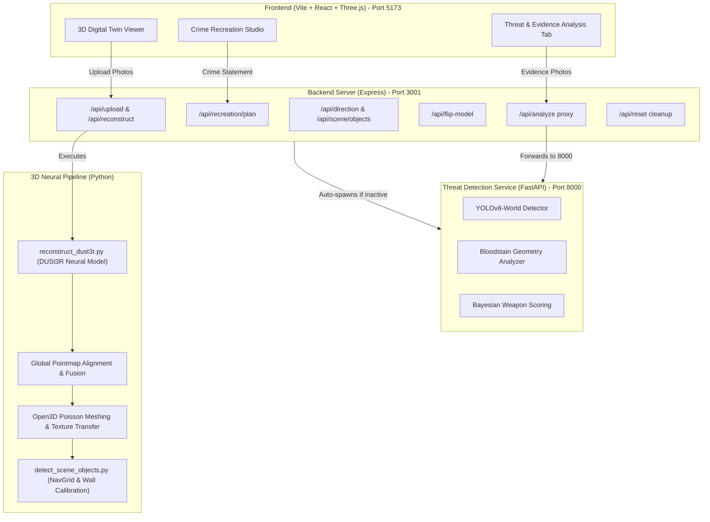

# 🏛️ AI Forensics & 3D Crime Scene Reconstruction

An end-to-end, AI-powered forensic spatial analysis platform. This system reconstructs textured 3D digital twins of physical crime scenes from multi-view photographs using **DUSt3R neural 3D reconstruction**, reenacts dynamic criminal incidents with animated 3D human mannequins and obstacle-avoiding navigation, and performs open-vocabulary weapon and bloodstain threat probability detection.

---

## 📑 Table of Contents

- [✨ Key Features](#-key-features)
- [🏗️ System Architecture](#️-system-architecture)
- [⚙️ Prerequisites](#️-prerequisites)
- [📦 Installation Guide](#-installation-guide)
  - [1. Clone Repository](#1-clone-repository)
  - [2. Install Node.js Dependencies](#2-install-nodejs-dependencies)
  - [3. Install Threat Detection Python Backend](#3-install-threat-detection-python-backend)
  - [4. Install 3D Reconstruction Python Packages](#4-install-3d-reconstruction-python-packages)
- [🚀 How to Run](#-how-to-run)
  - [Option A: Standard 2-Terminal Run (Recommended)](#option-a-standard-2-terminal-run-recommended)
  - [Option B: Explicit 3-Terminal Run](#option-b-explicit-3-terminal-run)
- [🧭 Module Walkthrough & Usage](#-module-walkthrough--usage)
  - [1. 🏢 3D Digital Twin Reconstruction](#1--3d-digital-twin-reconstruction)
  - [2. 🎬 Crime Recreation Studio](#2--crime-recreation-studio)
  - [3. 🔬 Threat & Evidence Analysis (FORENSIQ)](#3--threat--evidence-analysis-forensiq)
- [📡 API Endpoints Overview](#-api-endpoints-overview)
- [🛠️ Troubleshooting & Tips](#️-troubleshooting--tips)

---

## ✨ Key Features

1. **🏢 Neural 3D Digital Twin Reconstruction**:
   - **DUSt3R Neural Reconstruction**: Predicts dense 3D pointmaps and confidence weights directly from unconstrained, uncalibrated photographs without fragile SfM feature matching.
   - **Global Coordinate Fusion & Alignment**: Optimizes camera poses and point clouds via Minimum Spanning Tree (MST) and gradient descent alignment.
   - **Open3D Surface Meshing & Color Transfer**: Generates watertight surfaces with Poisson Surface Reconstruction and transfers photographic color maps.
   - **Local Floor Plane Fitting & Leveling**: Automatically estimates floor slope, levels geometry to Three.js canonical +Y-up orientation, and centers the room at origin.
   - **Automated Lifecycle & 1-Click Orientation Flip**: Cleans stale models upon new photo uploads and supports instant 180° room orientation flipping (`/api/flip-model`).

2. **🎬 Crime Incident Reenactment Studio**:
   - **Gemini AI & Rule-Based Incident Planner**: Converts natural language statements (e.g. _"The killer entered through the north door, approached the victim sitting on the couch, attacked, and fled via the east door"_) into chronologically staged simulation events.
   - **Proportional 3D Forensic Mannequins**: Dummy heights scale dynamically to match room ceiling height, executing natural postures (standing, sitting, fallen/prone).
   - **Obstacle-Avoiding 3D Navigation Grid (A\*)**:
     - Strict step-height rejection ($\le 12\text{cm}$) and smooth elevation penalties prevent dummies from stepping on furniture or elevated curbs.
     - Radius-aware Line-of-Sight (LOS) corridor clearance maintains safe clearance around furniture corners.
     - Physical object stamping marks tables, sofas, chairs, and beds onto the occupancy grid.
     - Natural standoff positioning: Attackers reach close contact distance ($0.38\text{m}\text{--}0.55\text{m}$) on walkable floor space without clipping objects.
     - Placement freedom: Victims can be seated or positioned directly on furniture without deflection.
     - Impenetrable perimeter floor bounds prevent dummies from stepping outside walls.
   - **8-Cardinal Compass & Wall Calibration**: Calibrates cardinal directions (N, NE, E, SE, S, SW, W, NW) and doorway portals to match physical room walls.
   - **Interactive Playback**: 60 FPS timeline scrubber, variable playback speed ($0.5\times$ to $4\times$), multi-angle camera modes (Director, Tactical 2D Overhead, Orbit, Follow Target), and video recording.

3. **🔬 AI Weapon & Threat Probability Detection (`FORENSIQ`)**:
   - **Open-Vocabulary YOLO-World**: Detects potential weapons (knives, firearms, blunt objects) and distinguishes them from everyday room objects.
   - **Bloodstain Geometry Segmentation**: Dual-threshold color segmentation maps impact spatters and blood pools with contour polygons.
   - **Bayesian Forensic Scoring**: Computes weapon probability ($0\text{--}100\%$) based on spatial proximity to bloodstains, object lethality, and blood contact transfer.
   - **Interactive Canvas**: High-precision bounding boxes, proximity connector lines, polygon overlays, and downloadable forensic summary reports.

---

## 🏗️ System Architecture



---

## ⚙️ Prerequisites

| Tool | Recommended Version | Purpose |
| --- | --- | --- |
| **Node.js** | `v18.x` or `v20.x`+ (with `npm`) | Runs Express backend and React frontend client |
| **Python** | `3.10` – `3.12` | Powers DUSt3R neural reconstruction and threat detection |
| **PyTorch** | `>= 2.1.0` | Powers neural pointmap inference (CUDA, Apple MPS, or CPU) |
| **Git** | `2.x`+ | Version control |

> [!NOTE]
> **No external COLMAP or OpenMVS binaries required!** The entire 3D pipeline runs natively in Python using PyTorch, DUSt3R, and Open3D.

---

## 📦 Installation Guide

### 1. Clone Repository

```bash
git clone https://github.com/Nishan169/AI-Forensics-3D-Reconstruction.git
cd AI-Forensics-3D-Reconstruction
```

### 2. Install Node.js Dependencies

Install dependencies for the root orchestration server:

```bash
npm install
```

Install dependencies for the React frontend client:

```bash
npm install --prefix frontend
```

### 3. Install Threat Detection Python Backend

The Threat Detection service runs as an isolated FastAPI microservice:

```bash
cd threat_backend
python3 -m venv venv

# macOS / Linux:
source venv/bin/activate
# Windows (PowerShell):
# .\venv\Scripts\Activate.ps1

pip install --upgrade pip
pip install -r requirements.txt
cd ..
```

_(Pre-trained YOLO weights `yolov8m-worldv2.pt` and `yolov8m.pt` are included in `threat_backend/` and will download automatically if missing)._

### 4. Install 3D Reconstruction Python Packages

Set up a virtual environment in the project root for the 3D reconstruction and forensic navigation pipeline:

```bash
python3 -m venv venv

# macOS / Linux:
source venv/bin/activate
# Windows (PowerShell):
# .\venv\Scripts\Activate.ps1

pip install --upgrade pip
pip install -r requirements.txt
```

#### Hardware Accelerator Options:
- **Apple Silicon (M1/M2/M3/M4 / MPS)**: Supported out of the box with `torch` and `torchvision`.
- **NVIDIA GPU (CUDA 12.1)**:
  ```bash
  pip install torch torchvision --index-url https://download.pytorch.org/whl/cu121
  ```
- **CPU Fallback**: DUSt3R and Open3D automatically run in CPU mode if no GPU is available.

---

## 🚀 How to Run

### Option A: Standard 2-Terminal Run (Recommended)

`server.js` automatically checks if the Python Threat Detection service is active; if not, it automatically spawns it in the background!

```bash
# Terminal 1: Start Backend Orchestration Server (Port 3001)
node server.js
```

```bash
# Terminal 2: Start Frontend Application (Port 5173)
npm run frontend
```

Now open **http://localhost:5173** in your web browser.

---

### Option B: Explicit 3-Terminal Run

```bash
# Terminal 1: Threat Detection Backend (Port 8000)
npm run threat:backend
```

```bash
# Terminal 2: Node.js Orchestration Backend (Port 3001)
npm start
```

```bash
# Terminal 3: Vite React Client (Port 5173)
npm run frontend
```

---

## 🧭 Module Walkthrough & Usage

### 1. 🏢 3D Digital Twin Reconstruction

1. In the left sidebar, click the **Scene Photos** dropzone and select or drag & drop multiple overlapping room photos (JPG/PNG).
2. Click **Generate 3D Room**.
3. Watch the real-time progress bar stream through neural pointmap inference, global coordinate alignment, Poisson surface reconstruction, and photographic color baking.
4. Orbit, pan, and zoom around the textured 3D digital twin using mouse controls.
5. Click **🎯 Face North** or click direction pills to align the room coordinates with physical room walls.
6. If the model orientation requires vertical inversion, click **🔄 Flip Orientation**.

### 2. 🎬 Crime Recreation Studio

1. Click the **🎬 Crime Recreation Studio** tab at the top.
2. In the prompt area, enter a natural language incident description:
   > _"The killer entered through the north door, walked to the victim sitting on the chair near the central living room table, shot the victim with a gun, and escaped via the north door."_
3. _(Optional)_ Provide your **Gemini API Key** in settings for advanced LLM prompt parsing (a deterministic heuristic engine is used if omitted).
4. Click **Generate 3D Reenactment Plan**.
5. Dummies simulate the exact incident timeline with collision-free paths around all furniture.
6. Use playback controls to **Play / Pause**, scrub the timeline, adjust speed ($0.5\times$ to $4\times$), toggle path lines, and switch perspectives (Director, Tactical Overhead, Orbit, Follow Target).

### 3. 🔬 Threat & Evidence Analysis (FORENSIQ)

1. Click the **🔬 Threat & Evidence Analysis** tab at the top.
2. Drag & drop or browse evidence photos of interest directly into the upload area.
3. The system instantly detects objects using open-vocabulary YOLO-World, highlights blood spatters and transfer pools, and calculates weapon probabilities.
4. Toggle between **Focused View** (single photo with interactive evidence inspection) and **View All (Stacked)**.
5. Hover over any weapon row in the sidebar to trace proximity lines to nearby bloodstains on the canvas.
6. Click **Download Forensic Report** to export evidence summaries for case files.

---

## 📡 API Endpoints Overview

### Orchestration Server (`http://localhost:3001`)

| Method | Endpoint | Description |
| --- | --- | --- |
| `POST` | `/api/upload` | Uploads scene photos and reference camera for 3D reconstruction |
| `POST` | `/api/reconstruct` | Triggers the DUSt3R neural 3D reconstruction pipeline |
| `GET` | `/api/status` | Server-Sent Events (SSE) streaming real-time reconstruction logs |
| `GET` | `/api/direction` | Returns calibrated cardinal compass angles and camera azimuth |
| `POST` | `/api/direction/calibrate` | Updates compass orientation with respect to physical room walls |
| `GET` | `/api/scene/objects` | Loads detected room objects, local floor elevation, and boundary markers |
| `POST` | `/api/recreation/plan` | Generates structured incident timeline and obstacle-avoiding simulation tracks |
| `POST` | `/api/flip-model` | Flips vertical room orientation and copies updated assets to frontend |
| `POST` | `/api/reset` | Purges prior models, textures, and reconstruction artifacts |
| `POST` | `/api/analyze` | Proxies image analysis requests to Threat Detection backend |

### Threat Detection Service (`http://127.0.0.1:8000`)

| Method | Endpoint | Description |
| --- | --- | --- |
| `GET` | `/api/health` | Service liveness health check |
| `POST` | `/api/analyze` | Processes image, returns bounding boxes, blood polygons, and probability scores |
| `POST` | `/api/analyze-batch` | Processes multiple images concurrently |

---

## 🛠️ Troubleshooting & Tips

- **Reconstruction Speed**: On Apple Silicon (M-series) or NVIDIA GPUs, DUSt3R completes reconstruction in ~1–3 minutes. On CPU-only machines, use 6–12 photos for optimal performance.
- **Dummies Clipping Objects**: The navigation engine automatically fits local floor planes and stamps furniture footprints. Ensure `output/navgrid.json` and `output/scene_objects.json` exist; click **Regenerate Plan** to refresh collision geometry.
- **Model Orientation**: If the room appears inverted, click **🔄 Flip Orientation** in the sidebar. This flips the Y-axis canonically and updates all room bounds automatically.
- **Gemini Incident Planning**: For statements with custom names or complex choreography, entering a free Google Gemini API key provides high-precision semantic parsing.
